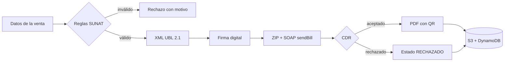

# 🧾 Plataforma de Facturación Electrónica Serverless y Procesamiento de Comprobantes

**Curso:** Servicios Cloud · **Grupo:** 4 · **Tema:** 10 – Plataforma de Facturación Electrónica Serverless y Procesamiento de Comprobantes · **Proveedor:** AWS

## Descripción
Plataforma para que PYMEs emitan **facturas y boletas electrónicas** según las reglas de la **SUNAT**, con costos proporcionales al uso: si no hay actividad, el costo es cero.
Cada comprobante se valida con las reglas de negocio, se convierte a **XML UBL 2.1**, se **firma digitalmente**, se envía por **SOAP** a la entidad tributaria (simulada), se recibe la constancia (**CDR**) y se genera la representación impresa en **PDF** con código QR.



## Estructura del repositorio
| Carpeta | Contenido |
|---|---|
| `api/` | API Express: reglas SUNAT, XML, firma, SOAP, PDF + Dockerfile |
| `sunat-mock/` | Entidad tributaria simulada (servicio SOAP) + Dockerfile |
| `infra/terraform/` | Infraestructura como código: red, DynamoDB, S3, EC2 |
| `postman/` | Colección de pruebas de la API |
| `ejemplos/` | Comprobantes de ejemplo (válidos e inválidos) y catálogos SUNAT |

## Estado del proyecto
| Fase | Descripción | Estado |
|---|---|---|
| 1 | Base del repositorio | ✅ |
| 2 | API con reglas SUNAT | ⏳ |
| 3 | SUNAT simulada (SOAP) | ⏳ |
| 4 | Contenedores Docker | ⏳ |
| 5 | Infraestructura con Terraform | ⏳ |
| 6 | Pruebas en AWS | ⏳ |
| 7 | Cierre del avance APF2 | ⏳ |

## Requisitos
- Git
- Docker Desktop
- Node.js 22 o superior
- Terraform 1.10 o superior
- AWS CLI v2 + Session Manager plugin

> Las instrucciones para ejecutar el proyecto se agregan en la Fase 4.

## Configuración
```bash
cp .env.example .env   # luego completa tus valores
```

## Reglas del repositorio
- Se trabaja en la rama **`dev`**; `main` contiene solo lo entregado.
- Mensajes de commit con [Conventional Commits](https://www.conventionalcommits.org/es/): `feat:`, `fix:`, `docs:`, `chore:`.
- **Nunca** se suben: `.env`, llaves de AWS, certificados (`.pem`, `.pfx`, `.key`), archivos `.tfstate` ni `.tfvars`.

## Integrantes
_Se completa en la Fase 7._
