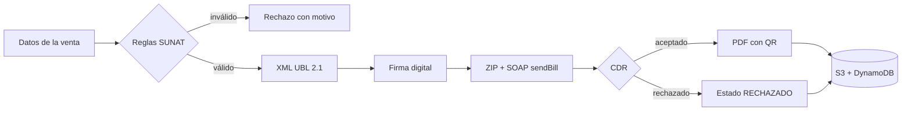
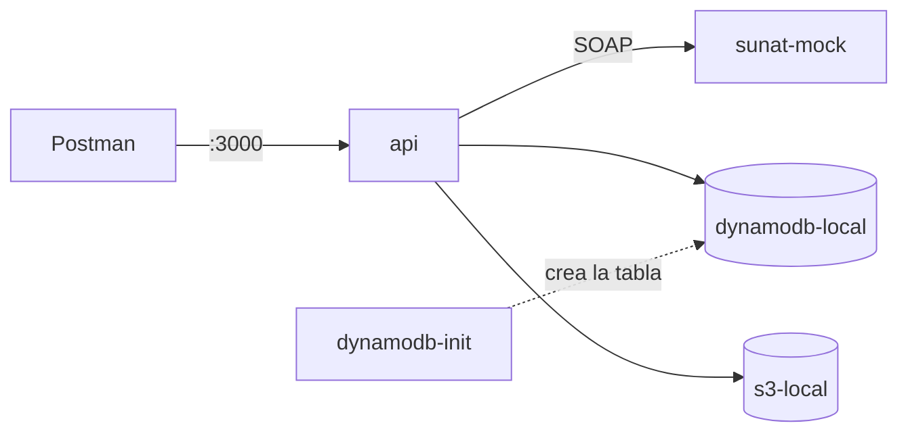
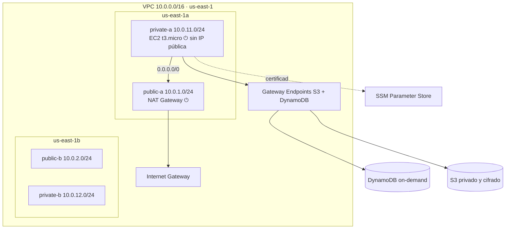

# 🧾 Plataforma de Facturación Electrónica Serverless y Procesamiento de Comprobantes

**Curso:** Servicios Cloud · **Grupo:** 4 · **Tema:** 10 – Plataforma de Facturación Electrónica Serverless y Procesamiento de Comprobantes · **Proveedor:** AWS

## Descripción
Plataforma para que PYMEs emitan **facturas y boletas electrónicas** según las reglas de la **SUNAT**, con costos proporcionales al uso: si no hay actividad, el costo es cero.
Cada comprobante se valida con las reglas de negocio, se convierte a **XML UBL 2.1**, se **firma digitalmente**, se envía por **SOAP** a la entidad tributaria (simulada), se recibe la constancia (**CDR**) y se genera la representación impresa en **PDF** con código QR.



## Estructura del repositorio
| Carpeta | Contenido |
|---|---|
| `api/` | API Express: reglas SUNAT, XML, firma, SOAP, PDF + Dockerfile |
| `sunat-mock/` | Entidad tributaria simulada (servicio SOAP) + Dockerfile |
| `infra/terraform/` | Infraestructura como código: red, DynamoDB, S3, EC2 |
| `postman/` | Colección de pruebas de la API |
| `ejemplos/` | Comprobantes de ejemplo (válidos e inválidos) y catálogos SUNAT |
| `scripts/` | `encender.ps1` / `apagar.ps1` (NAT + EC2 bajo demanda) y `probar-api.sh` (pruebas de humo) |
| `docker-compose.yml` | Entorno local completo: API, SUNAT simulada, DynamoDB local y S3 local |
| `docker-compose.aws.yml` | Versión para la EC2: API y SUNAT simulada con DynamoDB y S3 reales |

## Estado del proyecto
| Fase | Descripción | Estado |
|---|---|---|
| 1 | Base del repositorio | ✅ |
| 2 | API con reglas SUNAT | ✅ |
| 3 | SUNAT simulada (SOAP) | ✅ |
| 4 | Contenedores Docker | ✅ |
| 5 | Infraestructura con Terraform | ✅ |
| 6 | Pruebas en AWS | ✅ |
| 7 | Cierre del avance APF2 | ✅ |

## Requisitos
- Git
- Docker Desktop
- Node.js 22 o superior
- Terraform 1.10 o superior
- AWS CLI v2 + Session Manager plugin

## API (carpeta `api/`)
| Método y ruta | Descripción |
|---|---|
| `GET /health` | Estado de la API |
| `POST /comprobantes` | Emite una factura (01) o boleta (03): reglas SUNAT → XML UBL 2.1 → firma → SOAP → CDR → PDF |
| `GET /comprobantes/:id` | Consulta un comprobante (`RUC-TIPO-SERIE-NUMERO`) |

Pruebas automáticas:
```bash
cd api
npm install
npm run certificado   # certificado de prueba en api/certs/ (no se sube)
npm test
```

## SUNAT simulada (carpeta `sunat-mock/`)
Servicio SOAP que imita la ventanilla `sendBill` de SUNAT y responde con un CDR. Así la demo no depende del entorno beta de SUNAT.

| Respuesta | Cuándo |
|---|---|
| CDR `0` – aceptado | Comprobante firmado correctamente |
| CDR `2335` – rechazado | El XML fue modificado después de firmar (firma inválida) |
| CDR `2017` – rechazado | Factura a un RUC inactivo del padrón simulado (`RUCS_INACTIVOS`) |
| Falla `0102` | Usuario o clave SOL incorrectos |
| Falla `0151` / `0154` / `0155` / `0161` | Nombre del ZIP incorrecto, de otro RUC, ZIP dañado o sin el XML |

```bash
cd sunat-mock
npm install
npm test
npm start            # http://localhost:4000/health
```

## Ejecutar todo con Docker


```bash
cp .env.example .env
cd api && npm install && npm run certificado && cd ..   # certificado de prueba (solo la primera vez)
docker compose up -d --build
docker compose ps        # api, sunat-mock y s3-local "healthy"; dynamodb-init "Exited (0)"
```

| Contenedor | Imagen | Puerto |
|---|---|---|
| `api` | `api/Dockerfile` (multi-stage, `node:22-alpine`, usuario no-root) | 3000 |
| `sunat-mock` | `sunat-mock/Dockerfile` (multi-stage, `node:22-alpine`, usuario no-root) | 4000 |
| `dynamodb-local` | `amazon/dynamodb-local` | 8000 |
| `s3-local` | `adobe/s3mock` (crea el bucket al iniciar) | 9090 |
| `dynamodb-init` | misma imagen de `api`: crea la tabla y termina | — |

- Las pruebas de la API están en `postman/` (importar en Postman y ejecutar con el Runner).
- Los datos se guardan en volúmenes: sobreviven a `docker compose down`. Para borrarlos: `docker compose down -v`.
- `docker-compose.aws.yml` es la versión para la EC2: solo `api` y `sunat-mock`, con DynamoDB y S3 reales y el rol IAM de la instancia.

## Infraestructura en AWS (carpeta `infra/terraform/`)

⏻ Recursos que cobran por hora: se crean solo para pruebas y demo.

| Archivo | Recursos |
|---|---|
| `bootstrap/` | Bucket S3 del state (versionado, cifrado, privado) |
| `red.tf` | VPC, 2 subredes públicas y 2 privadas en 2 zonas, Internet Gateway, NAT (opcional), tablas de rutas, Gateway Endpoints |
| `seguridad.tf` | Security Group sin reglas de entrada, rol IAM de mínimo privilegio |
| `datos.tf` | DynamoDB `PAY_PER_REQUEST` con PITR, bucket S3 (bloqueo público, cifrado, versionado, ciclo de vida, solo TLS) |
| `secretos.tf` | Certificado de firma en SSM Parameter Store (llave como `SecureString`) |
| `computo.tf` | EC2 t3.micro en subred privada, IMDSv2, disco cifrado; `user-data.sh.tftpl` instala Docker y levanta `docker-compose.aws.yml` |
| `costos.tf` | AWS Budget mensual con alertas por correo |

```powershell
cd infra/terraform
copy backend.hcl.example backend.hcl            # completar el ID de la cuenta
copy terraform.tfvars.example terraform.tfvars  # completar el correo
terraform init -backend-config="backend.hcl"
terraform apply                                  # capa permanente: costo ~0
```

| Acción | Comando | Costo |
|---|---|---|
| Encender NAT + EC2 | `.\scripts\encender.ps1` | ~0.06 USD/h |
| Apagar NAT + EC2 (conserva datos) | `.\scripts\apagar.ps1` | 0 |
| Entrar a la EC2 (sin SSH) | `aws ssm start-session --target <id>` | — |
| Borrar todo al terminar el curso | `terraform destroy` | — |

### Probar en AWS
La EC2 no tiene IP pública ni puertos abiertos: las pruebas se ejecutan **desde dentro** con Session Manager.
```powershell
.\scripts\encender.ps1                              # NAT + EC2; esperar ~5 min al arranque
aws ssm start-session --target <id-de-la-ec2>       # o Consola EC2 → Conectar → Administrador de sesiones
```
```bash
cd /opt/facturacion
sudo docker compose -f docker-compose.aws.yml ps    # api y sunat-mock "healthy"
bash scripts/probar-api.sh                          # 8 casos: aceptado, rechazado, R08, R10, R12, consulta
sudo reboot                                         # persistencia: los contenedores vuelven solos (restart: always)
```
```powershell
.\scripts\apagar.ps1                                # borra NAT + EC2; DynamoDB y S3 se conservan
```

Resultado de la prueba del 17/10/2026: 8/8 casos correctos en AWS, persistencia verificada tras reinicio, ~41 min encendido (≈ 0.04 USD).

## Configuración
```bash
cp .env.example .env   # luego completa tus valores
```

## Reglas del repositorio
- Se trabaja en la rama **`dev`**; `main` contiene solo lo entregado.
- Mensajes de commit con [Conventional Commits](https://www.conventionalcommits.org/es/): `feat:`, `fix:`, `docs:`, `chore:`.
- **Nunca** se suben: `.env`, llaves de AWS, certificados (`.pem`, `.pfx`, `.key`), archivos `.tfstate` ni `.tfvars`.

## Próximos pasos (APF3)
La lógica ya está separada en pasos independientes (`api/src/servicios/emitir-comprobante.js`), preparada para pasar a una arquitectura 100 % serverless:

| Componente | APF2 (actual) | APF3 |
|---|---|---|
| Cómputo | Contenedores en EC2 | Funciones **AWS Lambda** desplegadas con **Serverless Framework** |
| Orquestación | Pasos en secuencia dentro de la API | **Step Functions**: validar → XML → firmar → enviar → PDF, con reintentos |
| Exposición | Solo red privada | **API Gateway** con JWT, API keys y límite de peticiones (rate limiting) |
| Eventos | — | **Triggers de S3** (generar el PDF al llegar el XML firmado) |
| Monitoreo | Logs de contenedores | **CloudWatch**: métricas, alarmas y dashboards |

## Integrantes
| Integrante | Rol | GitHub |
|---|---|---|
| Julio César Julca Gonzales | Arquitecto cloud | [@ProgAlphaX](https://github.com/ProgAlphaX) |
| Sergio Cristofer Davila Naves | Pruebas de la API (Postman) | [@cristofer-s-dn](https://github.com/cristofer-s-dn) |
| Romina Ariadna Romero Rivas | Extensiones recomendadas de VS Code | [@Ariadna019](https://github.com/Ariadna019) |
| Camila Alesandra Borja Zegarra | Casos de prueba de validación (`ejemplos/`) | [@Camibz29](https://github.com/Camibz29) |
| Rony Laura Luna | Guía de contribución (`CONTRIBUTING.md`) | [@ronylaural-ux](https://github.com/ronylaural-ux) |
