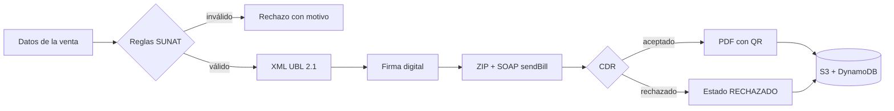
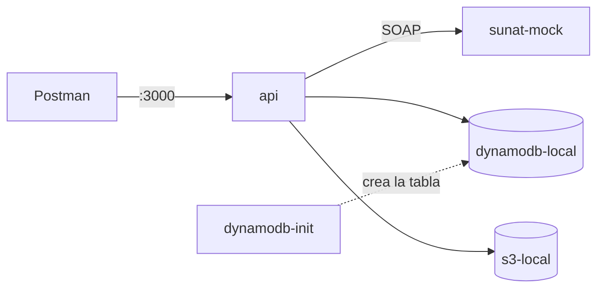
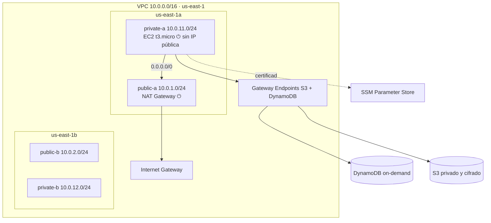
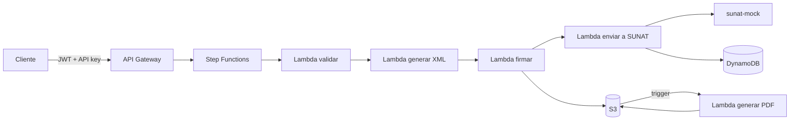
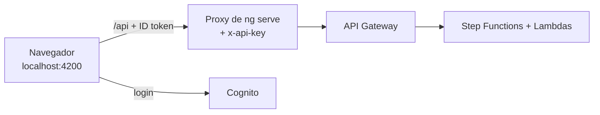

# 🧾 Plataforma de Facturación Electrónica Serverless y Procesamiento de Comprobantes

**Curso:** Servicios Cloud · **Grupo:** 4 · **Tema:** 10 – Plataforma de Facturación Electrónica Serverless y Procesamiento de Comprobantes · **Proveedor:** AWS

## Descripción

Plataforma para que PYMEs emitan **facturas y boletas electrónicas** según las reglas de la **SUNAT**, con costos proporcionales al uso: si no hay actividad, el costo es cero.
Cada comprobante se valida con las reglas de negocio, se convierte a **XML UBL 2.1**, se **firma digitalmente**, se envía por **SOAP** a la entidad tributaria (simulada), se recibe la constancia (**CDR**) y se genera la representación impresa en **PDF** con código QR.



## Estructura del repositorio

| Carpeta                  | Contenido                                                                                  |
| ------------------------ | ------------------------------------------------------------------------------------------ |
| `api/`                   | API Express: reglas SUNAT, XML, firma, SOAP, PDF + Dockerfile                              |
| `sunat-mock/`            | Entidad tributaria simulada (servicio SOAP) + Dockerfile                                   |
| `infra/terraform/`       | Infraestructura como código: red, DynamoDB, S3, EC2                                        |
| `postman/`               | Colección de pruebas de la API                                                             |
| `ejemplos/`              | Comprobantes de ejemplo (válidos e inválidos) y catálogos SUNAT                            |
| `scripts/`               | `encender.ps1` / `apagar.ps1` (NAT + EC2 bajo demanda) y `probar-api.sh` (pruebas de humo) |
| `docker-compose.yml`     | Entorno local completo: API, SUNAT simulada, DynamoDB local y S3 local                     |
| `docker-compose.aws.yml` | Versión para la EC2: API y SUNAT simulada con DynamoDB y S3 reales                         |
| `serverless/`            | APF3: Lambdas, Step Functions, API Gateway, Cognito y CloudWatch (Serverless Framework)    |
| `frontend/`              | Web local en Angular 22 que usa la API del APF3 (login, facturar y consultar)              |

## Estado del proyecto

| Fase     | Descripción                                          | Estado |
| -------- | ---------------------------------------------------- | ------ |
| APF2 1–7 | Repositorio, API, SUNAT simulada, Docker, Terraform y pruebas en AWS | ✅ |
| APF3 1   | Base serverless (Serverless Framework + esbuild)     | ✅     |
| APF3 2   | SUNAT simulada como Lambda con URL de función        | ✅     |
| APF3 3   | Siete funciones Lambda del flujo, un rol IAM cada una | ✅    |
| APF3 4   | Máquina de estados Step Functions Express            | ✅     |
| APF3 5   | API Gateway + Cognito (JWT) + API key + límite       | ✅     |
| APF3 6   | Trigger de S3 que genera el PDF                      | ✅     |
| APF3 7   | Panel de CloudWatch y logs a 7 días                  | ✅     |
| APF3 8   | Pruebas de integración (script y Postman)            | ✅     |
| APF3 9–10 | Informe v3.0 y cierre (tag `v0.3-apf3`)             | ✅     |
| Web 1    | Backend encendido y credenciales para la web        | ✅     |
| Web 2    | Proyecto Angular 22 y proxy local                    | ✅     |
| Web 3    | Login con Cognito (renovación de token y rutas protegidas) | ✅ |
| Web 4    | Pantalla Facturar con reglas en vivo y ejemplos      | ✅     |
| Web 5    | Consulta de comprobantes e historial local           | ✅     |
| Web 6    | Listado y descargas desde AWS (2 rutas y 2 Lambdas nuevas) | ✅ |
| Web 7    | Modo demo, ensayo y cierre                           | ⏳     |

## Requisitos

- Git
- Docker Desktop
- Node.js 22 o superior
- Terraform 1.10 o superior
- AWS CLI v2 + Session Manager plugin

## API (carpeta `api/`)

| Método y ruta           | Descripción                                                                                 |
| ----------------------- | ------------------------------------------------------------------------------------------- |
| `GET /health`           | Estado de la API                                                                            |
| `POST /comprobantes`    | Emite una factura (01) o boleta (03): reglas SUNAT → XML UBL 2.1 → firma → SOAP → CDR → PDF |
| `GET /comprobantes/:id` | Consulta un comprobante (`RUC-TIPO-SERIE-NUMERO`)                                           |

Pruebas automáticas:

```bash
cd api
npm install
npm run certificado   # certificado de prueba en api/certs/ (no se sube)
npm test
```

## SUNAT simulada (carpeta `sunat-mock/`)

Servicio SOAP que imita la ventanilla `sendBill` de SUNAT y responde con un CDR. Así la demo no depende del entorno beta de SUNAT.

| Respuesta                               | Cuándo                                                           |
| --------------------------------------- | ---------------------------------------------------------------- |
| CDR `0` – aceptado                      | Comprobante firmado correctamente                                |
| CDR `2335` – rechazado                  | El XML fue modificado después de firmar (firma inválida)         |
| CDR `2017` – rechazado                  | Factura a un RUC inactivo del padrón simulado (`RUCS_INACTIVOS`) |
| Falla `0102`                            | Usuario o clave SOL incorrectos                                  |
| Falla `0151` / `0154` / `0155` / `0161` | Nombre del ZIP incorrecto, de otro RUC, ZIP dañado o sin el XML  |

```bash
cd sunat-mock
npm install
npm test
npm start            # http://localhost:4000/health
```

## Ejecutar todo con Docker



```bash
cp .env.example .env
cd api && npm install && npm run certificado && cd ..   # certificado de prueba (solo la primera vez)
docker compose up -d --build
docker compose ps        # api, sunat-mock y s3-local "healthy"; dynamodb-init "Exited (0)"
```

| Contenedor       | Imagen                                                                   | Puerto |
| ---------------- | ------------------------------------------------------------------------ | ------ |
| `api`            | `api/Dockerfile` (multi-stage, `node:22-alpine`, usuario no-root)        | 3000   |
| `sunat-mock`     | `sunat-mock/Dockerfile` (multi-stage, `node:22-alpine`, usuario no-root) | 4000   |
| `dynamodb-local` | `amazon/dynamodb-local`                                                  | 8000   |
| `s3-local`       | `adobe/s3mock` (crea el bucket al iniciar)                               | 9090   |
| `dynamodb-init`  | misma imagen de `api`: crea la tabla y termina                           | —      |

- Las pruebas de la API están en `postman/` (importar en Postman y ejecutar con el Runner).
- Los datos se guardan en volúmenes: sobreviven a `docker compose down`. Para borrarlos: `docker compose down -v`.
- `docker-compose.aws.yml` es la versión para la EC2: solo `api` y `sunat-mock`, con DynamoDB y S3 reales y el rol IAM de la instancia.

## Infraestructura en AWS (carpeta `infra/terraform/`)



⏻ Recursos que cobran por hora: se crean solo para pruebas y demo.

| Archivo        | Recursos                                                                                                                      |
| -------------- | ----------------------------------------------------------------------------------------------------------------------------- |
| `bootstrap/`   | Bucket S3 del state (versionado, cifrado, privado)                                                                            |
| `red.tf`       | VPC, 2 subredes públicas y 2 privadas en 2 zonas, Internet Gateway, NAT (opcional), tablas de rutas, Gateway Endpoints        |
| `seguridad.tf` | Security Group sin reglas de entrada, rol IAM de mínimo privilegio                                                            |
| `datos.tf`     | DynamoDB `PAY_PER_REQUEST` con PITR, bucket S3 (bloqueo público, cifrado, versionado, ciclo de vida, solo TLS)                |
| `secretos.tf`  | Certificado de firma en SSM Parameter Store (llave como `SecureString`)                                                       |
| `computo.tf`   | EC2 t3.micro en subred privada, IMDSv2, disco cifrado; `user-data.sh.tftpl` instala Docker y levanta `docker-compose.aws.yml` |
| `costos.tf`    | AWS Budget mensual con alertas por correo                                                                                     |

```powershell
cd infra/terraform
copy backend.hcl.example backend.hcl            # completar el ID de la cuenta
copy terraform.tfvars.example terraform.tfvars  # completar el correo
terraform init -backend-config="backend.hcl"
terraform apply                                  # capa permanente: costo ~0
```

| Acción                            | Comando                               | Costo       |
| --------------------------------- | ------------------------------------- | ----------- |
| Encender NAT + EC2                | `.\scripts\encender.ps1`              | ~0.06 USD/h |
| Apagar NAT + EC2 (conserva datos) | `.\scripts\apagar.ps1`                | 0           |
| Entrar a la EC2 (sin SSH)         | `aws ssm start-session --target <id>` | —           |
| Borrar todo al terminar el curso  | `terraform destroy`                   | —           |

### Probar en AWS

La EC2 no tiene IP pública ni puertos abiertos: las pruebas se ejecutan **desde dentro** con Session Manager.

```powershell
.\scripts\encender.ps1                              # NAT + EC2; esperar ~5 min al arranque
aws ssm start-session --target <id-de-la-ec2>       # o Consola EC2 → Conectar → Administrador de sesiones
```

```bash
cd /opt/facturacion
sudo docker compose -f docker-compose.aws.yml ps    # api y sunat-mock "healthy"
bash scripts/probar-api.sh                          # 8 casos: aceptado, rechazado, R08, R10, R12, consulta
sudo reboot                                         # persistencia: los contenedores vuelven solos (restart: always)
```

```powershell
.\scripts\apagar.ps1                                # borra NAT + EC2; DynamoDB y S3 se conservan
```

Resultado de la prueba del 17/10/2026: 8/8 casos correctos en AWS, persistencia verificada tras reinicio, ~41 min encendido (≈ 0.04 USD).

## Configuración

```bash
cp .env.example .env   # luego completa tus valores
```

## Reglas del repositorio

- Se trabaja en la rama **`dev`**; `main` contiene solo lo entregado.
- Mensajes de commit con [Conventional Commits](https://www.conventionalcommits.org/es/): `feat:`, `fix:`, `docs:`, `chore:`.
- **Nunca** se suben: `.env`, llaves de AWS, certificados (`.pem`, `.pfx`, `.key`), archivos `.tfstate` ni `.tfvars`.

## Arquitectura APF3 (serverless)

En el APF3 cada paso del flujo pasa a ser una función **AWS Lambda**, ordenada por **Step Functions** y expuesta por **API Gateway** (API key, JWT y límite de peticiones).



| Componente   | APF2                   | APF3                                         |
| ------------ | ---------------------- | -------------------------------------------- |
| Cómputo      | Contenedores en EC2    | Funciones AWS Lambda (Serverless Framework)  |
| Orquestación | Pasos dentro de la API | Step Functions                               |
| Exposición   | Solo red privada       | API Gateway con JWT, API key y rate limiting |
| Eventos      | —                      | Trigger de S3 que genera el PDF              |
| Monitoreo    | Logs de contenedores   | CloudWatch                                   |

Los handlers de las Lambdas están en `api/src/lambdas/` y sus pruebas en `api/tests/`.

### Rutas de la API desplegada

Todas exigen el JWT de Cognito (`Authorization`) y la llave de API (`x-api-key`), y comparten el límite de 5 peticiones por segundo.

| Ruta | Lambda | Qué hace |
| ---- | ------ | -------- |
| `POST /comprobantes` | Step Functions (integración directa) | Emite una factura o boleta: 201 `ACEPTADO` o `RECHAZADO`, 400 `INVALIDO`, 409 `DUPLICADO`, 502 `ERROR_ENVIO` |
| `GET /comprobantes/{id}` | `consultar-comprobante` | Devuelve el registro completo (`RUC-TIPO-SERIE-NUMERO`) |
| `GET /comprobantes?estado=&limite=&desde=` | `listar-comprobantes` | Lista paginada del emisor, del más nuevo al más antiguo (límite por defecto 50, máximo 100), con el conteo por estado |
| `GET /comprobantes/{id}/archivos/{xml\|cdr\|pdf}` | `descargar-archivo` | Devuelve una URL de S3 que vence a los 5 minutos; la clave del archivo sale de DynamoDB, no de lo que envíe quien llama |

Cada Lambda tiene su propio rol IAM de mínimo privilegio (`dynamodb:Query` para listar; `GetItem` y `s3:GetObject` solo sobre `firmados/`, `cdr/` y `pdf/` para descargar).

### Desplegar, probar y destruir el APF3

Requisitos: AWS CLI con el perfil `fe-dev`, Node.js 22 o superior, PowerShell 7 y la capa permanente de Terraform ya creada (`terraform apply` en `infra/terraform/`).

```powershell
# 1. Desplegar (1 a 4 minutos). Muestra UrlApi, GrupoUsuariosId, ClienteApiId y LlaveApiId
cd serverless
npm ci
npx serverless deploy

# 2. Crear el usuario de prueba de Cognito (una sola vez; elija su propia contraseña de 12 o más caracteres)
aws cognito-idp admin-create-user --user-pool-id <GrupoUsuariosId> --username tester --message-action SUPPRESS --profile fe-dev --region us-east-1
aws cognito-idp admin-set-user-password --user-pool-id <GrupoUsuariosId> --username tester --password "<clave>" --permanent --profile fe-dev --region us-east-1

# 3. Probar la API desplegada (15 casos; pide la contraseña, no se guarda)
./scripts/probar-api.ps1
```

Para no generar costos al terminar: `npx serverless remove` en `serverless/` y después `terraform destroy` en `infra/terraform/`. El NAT Gateway y la EC2 del APF2 siguen apagados por defecto (`enable_nat` y `enable_ec2` en `false`). La API key y el JWT nunca se suben al repositorio: se obtienen con `aws apigateway get-api-key` y `aws cognito-idp initiate-auth`.

## Web local (carpeta `frontend/`)

Interfaz en **Angular 22** para usar la API del APF3 sin Postman: iniciar sesión con Cognito, emitir facturas y boletas, y consultar cada comprobante. Corre solo en local (no se publica) y **no modifica el backend**: el servidor de desarrollo reenvía `/api` a API Gateway agregando la llave de API, así el navegador no necesita CORS ni conoce la llave.



| Pantalla | Qué hace |
| --- | --- |
| Iniciar sesión | Cognito con usuario y contraseña; el token se renueva solo |
| Inicio | Resumen de lo emitido desde la web |
| Facturar | Formulario con totales automáticos, reglas R01–R11 en vivo, 9 ejemplos y el resultado de cada caso |
| Comprobantes | Listado desde AWS (todo lo emitido, también desde Postman), filtro por estado, «Cargar más», consulta por número y descarga del PDF |
| Detalle | Datos, respuesta de SUNAT y descarga del XML, el CDR y el PDF (enlace temporal de S3) |

```powershell
# Con la pila del APF3 desplegada y el usuario de Cognito creado (ver sección anterior)
cd frontend
npm ci
Copy-Item .env.example .env.local   # completar API_URL, COGNITO_CLIENT_ID y API_KEY
npm start                           # http://localhost:4200
```

Calidad: TypeScript estricto y ESLint sin `any` (`npm run typecheck`, `npm run lint`), más 77 pruebas (`npm test -- --watch=false`); el backend tiene 115 (`npm test` en `api/`). El detalle de arquitectura, estructura y límites conocidos está en [`frontend/README.md`](frontend/README.md).

## Integrantes

| Integrante                     | Rol                                         | GitHub                                               |
| ------------------------------ | ------------------------------------------- | ---------------------------------------------------- |
| Julio César Julca Gonzales     | Arquitecto cloud                            | [@ProgAlphaX](https://github.com/ProgAlphaX)         |
| Sergio Cristofer Davila Naves  | Pruebas de la API (Postman)                 | [@cristofer-s-dn](https://github.com/cristofer-s-dn) |
| Romina Ariadna Romero Rivas    | Extensiones recomendadas de VS Code         | [@Ariadna019](https://github.com/Ariadna019)         |
| Camila Alesandra Borja Zegarra | Casos de prueba de validación (`ejemplos/`) | [@Camibz29](https://github.com/Camibz29)             |
| Rony Laura Luna                | Guía de contribución (`CONTRIBUTING.md`)    | [@ronylaural-ux](https://github.com/ronylaural-ux)   |
