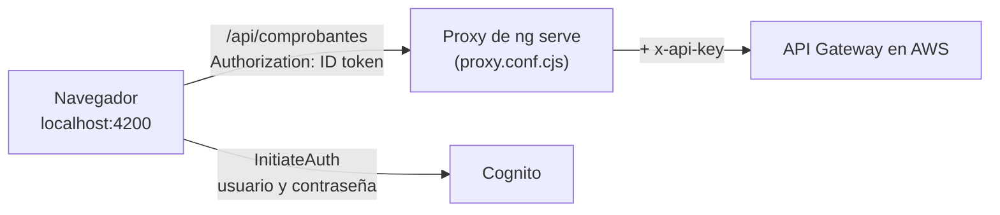

# FacturaNube · Web local

Interfaz web (Angular 22) para usar la plataforma de facturación del APF3 sin Postman: iniciar sesión, emitir facturas y boletas, y consultar, listar y descargar cada comprobante. **Solo corre en local** (no se publica). El flujo de emisión del backend no se tocó; para el listado y las descargas se agregaron dos rutas y dos Lambdas (ver el README principal).

## Qué incluye

| Pantalla | Qué hace |
| --- | --- |
| **Iniciar sesión** | Usuario y contraseña de Cognito. La sesión vive en `sessionStorage` (se borra al cerrar la pestaña) y la contraseña nunca se guarda. |
| **Inicio** | Tarjetas con el conteo por estado de todos los comprobantes guardados en AWS. |
| **Facturar** | Formulario de factura o boleta con ítems dinámicos y totales automáticos. Revisa en vivo las reglas R01–R05 y R07–R11 y muestra el resultado de cada caso (aceptado, rechazado por SUNAT, reglas incumplidas, duplicado, error de envío, 429, sin conexión, tiempo agotado). Incluye 9 ejemplos y un «modo prueba» para enviar aunque haya avisos. |
| **Comprobantes** | Lista desde AWS (también lo emitido por Postman o scripts), filtro por estado con conteos, «Cargar más», consulta por número y descarga del PDF. |
| **Detalle** | Cliente, ítems, totales y respuesta de SUNAT. Descarga del XML, el CDR y el PDF con enlaces temporales de S3 (vencen a los 5 minutos). Si el comprobante fue aceptado, espera unos segundos a que aparezca el PDF. |

## Cómo funciona la conexión



- **Sin CORS:** el navegador solo habla con `localhost`; el proxy de `ng serve` reenvía `/api` a API Gateway. Por eso no hizo falta tocar AWS.
- **La llave de API no está en el código de la web:** la agrega el proxy leyéndola de `.env.local`.
- **Login directo a Cognito** con `USER_PASSWORD_AUTH` (el cliente del APF3 ya lo permite). El ID token se renueva solo si está por vencer o ante un 401.

## Requisitos

- Node.js 22 o superior.
- El backend del APF3 desplegado (`npx serverless deploy` en `serverless/`) y un usuario de Cognito con contraseña definitiva. Los pasos están en el README principal, sección *Desplegar, probar y destruir el APF3*.

## Puesta en marcha

```powershell
cd frontend
npm ci
Copy-Item .env.example .env.local   # y completa los valores (ver abajo)
npm start                           # http://localhost:4200
```

`.env.local` necesita `API_URL`, `COGNITO_REGION`, `COGNITO_CLIENT_ID` y `API_KEY` (el archivo `.env.example` indica de dónde sale cada uno). Está ignorado por git. `npm start` genera `src/app/core/config/entorno.generado.ts` con los datos que **no** son secretos (región y cliente de Cognito); ese archivo tampoco se sube.

> Cada `serverless deploy` crea una llave de API nueva: actualiza `API_KEY` y reinicia `npm start`.

## Calidad

| Comando | Qué revisa |
| --- | --- |
| `npm run typecheck` | Compilación estricta de la app y de las pruebas |
| `npm run lint` | ESLint con `no-explicit-any` y las reglas `no-unsafe-*` como error |
| `npm test -- --watch=false` | Pruebas unitarias y de componentes (Vitest) |
| `npm run build` | Compilación de producción |

El tipado es estricto: `strict`, `noUncheckedIndexedAccess`, `exactOptionalPropertyTypes` y `strictTemplates`. Las respuestas de la API entran como `unknown` y se validan antes de convertirse en tipos (`leerComprobante`, `interpretarRespuesta`), así que un cuerpo inesperado nunca rompe una pantalla.

## Estructura

```
src/app/
├── core/
│   ├── config/        entorno (región y cliente de Cognito)
│   ├── models/        tipos del comprobante y de cada respuesta de la API (emisión, consulta, listado y descarga)
│   ├── reglas/        copia local de las reglas R01–R11 (la palabra final es del backend)
│   ├── ejemplos/      comprobantes de ejemplo con la fecha de hoy
│   ├── services/      auth y comprobantes (emitir, consultar, listar y pedir la URL de descarga)
│   ├── interceptors/  agrega y renueva el ID token
│   └── guards/        rutas protegidas
├── features/          auth, inicio, facturar, comprobantes (lista y detalle)
├── layout/            estructura con menú lateral y barra superior
└── shared/ui/         piezas comunes (etiqueta de estado)
```

## Límites conocidos

- El listado trae como máximo 2 000 comprobantes del emisor por consulta (tope de seguridad del backend) y ordena en memoria por fecha de creación.
- Los enlaces de descarga duran 5 minutos: mientras no venzan, quien tenga el enlace puede bajar ese archivo sin iniciar sesión, por eso la web no los guarda.
- R06 (RUC del emisor) y R12 (duplicados) solo las decide AWS; R10 y R11 no se pueden provocar desde la pantalla porque los totales se calculan solos.

## Costo

Mientras la pila serverless está encendida solo se paga por uso. Al terminar: `npx serverless remove` en `serverless/`.
